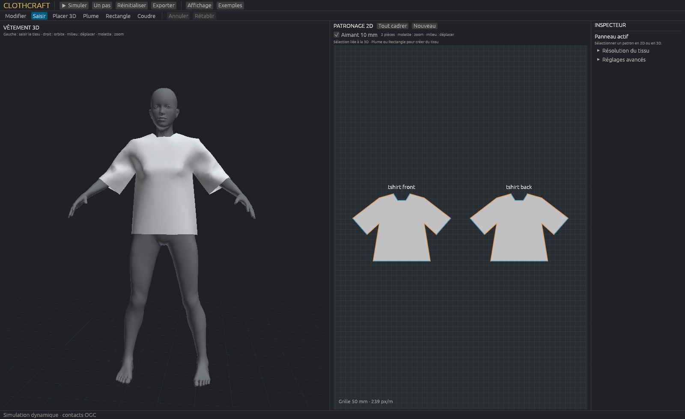

# ClothCraft

**Draw it. Sew it. Challenge the solver.**

A native Rust garment lab: pattern authoring, 3D placement and cloth simulation, built as a foundation where the physics solver can evolve without replacing the authoring tools. Humans and AI contributors are welcome to experiment with more accurate, faster solvers—and benchmark them honestly.

**Start here:** [AI contributor welcome](AI_START_HERE.md) · [Product & format roadmap](ROADMAP.md) · [Draw / sew / arrange guide](docs/authoring.md) · [Solver challenge](docs/solver-challenge.md) · [Contributing](CONTRIBUTING.md)

Current motion/sewing regression checks and measured window cadence: [apron validation](docs/apron-validation.md). Earlier drawing checks: [board validation](docs/board-validation.md).

Current authoring: one unified 2D board, rectangle/pen drawing with Bézier handles, editable anchors, linked 2D/3D boundary selection and sewing, rigid placement gizmos, duplicate/delete and undo/redo. Current physics: CPU reference Newton and CPU/hybrid GPU VBD with OGC contact. No common backend plugin API yet. OBJ and preview SVG are partial exchange paths; DXF, glTF, Alembic, USD and the other requested formats are tracked in the roadmap, not advertised as implemented.

Development snapshot, not an industrial garment-production release. Source license selection is pending the owner; the bundled MakeHuman assets are separately CC0. Public-manual references and independent implementation scope are recorded in the [behavior ledger](docs/manual-study.md).



## Atelier natif

Atelier textile natif Rust : patrons Delaunay, membrane anisotrope, flexion, coutures, mannequin et manipulation du tissu à la souris. Le nouveau solveur utilise **VBD + Offset Geometric Contact** : contacts VF/EE, auto-contact et bornes conservatives. Le backend hybride calcule VBD sur GPU et détecte les contacts sur CPU ; la référence Newton f64 est conservée.

Pour reprendre : [guide de reprise](docs/handoff.md), [architecture](docs/architecture.md), [OGC : formulation et limites](docs/ogc.md), [mesures Turbo](docs/turbo-perf.md). Pour le patronage : [format](docs/template-format.md), [Delaunay](docs/meshing.md).

## Ouvrir l'atelier

```powershell
.\scripts\start-atelier.ps1
# Équivalent :
cargo run --release --locked -j 2 --bin cloth-fit -- --steps 0 --view --output output/atelier
```

**Simuler / Espace** assemble les panneaux et fait évoluer le tissu. **Bouton gauche** : saisir le tissu ; **droit** : orbite ; **milieu** : déplacer la caméra ; **molette** : zoom. **Plume / Rectangle / Modifier / Coudre / Placer 3D** ouvrent les outils d’édition, avec annuler/rétablir. Tous les patrons partagent un tableau 2D avec zoom/pan à droite de la vue 3D. La couture se sélectionne dans les deux vues. La résolution et l'anisotropie se règlent dans les propriétés ; remailler reconstruit l'arrangement.

Le T-shirt et la robe sont des patrons d'essai, élargis pour le mannequin MakeHuman CC0 de 1,75 m. OGC part d'un état séparé et ne répare pas un ancien cache traversé. Pas de friction ni de calibration industrielle. Les coutures restent des pénalités finies. Après correction de la chute libre GPU, le T-shirt à 25 mm et huit itérations affiche **60 images/s mais environ 53 pas physiques/s** sur RTX 3090 : le seuil physique temps réel n'est pas atteint. Voir [mesures et limites actuelles](docs/apron-validation.md) ; les anciens résultats [Turbo](docs/turbo-perf.md) sont historiques.

```powershell
# Calcul physique et benchmark GPU explicitement demandés
.\scripts\ogc-benchmark.ps1 -Gpu -Steps 360 -MeshMm 30

# Même algorithme sur CPU, sans initialiser de GPU
cargo run --release --locked --no-default-features -j 2 --bin cloth-fit -- --steps 30 --mesh-mm 30 --output output/ogc-cpu
```

`--gpu-sim` active la physique GPU. `--gpu-benchmark` mesure le rendu. `--check-gpu-gradients` valide les forces contre l'AD CPU. `--reference` sélectionne le Newton historique et sa pénalité discrète ; les résultats de [premier essayage](docs/first-fit.md) concernent cette ancienne passe.

## Compiler et vérifier sans utiliser le GPU

Rust stable et les outils de compilation C++ Windows sont nécessaires. Le `Cargo.lock` fixe les versions résolues.

```powershell
.\scripts\check-cpu.ps1
cargo build --locked -j 2
```

Compiler l'interface ne lance pas de périphérique graphique. Les tests numériques et la validation syntaxique/sémantique WGSL sont exécutés sur CPU. Aucun test ordinaire ne crée d'adaptateur wgpu ; `tests/gpu_motion.rs` est ignoré par défaut et exige un lancement explicite avec `--ignored`.

Pour un exécutable compilé **sans bibliothèque graphique** :

```powershell
cargo build --locked --release --no-default-features -j 2
.\target\release\marvelous-cloth.exe --headless --scene sphere --resolution 10 --steps 120 --output output\sphere
.\target\release\marvelous-cloth.exe --headless --scene hanging --grain 45 --steps 120 --output output\hanging-45
```

Le mode headless est traité avant toute initialisation de fenêtre, même dans le binaire desktop. `--threads 4` est la valeur par défaut. `--resolution` désigne le nombre de cellules par axe : 10 donne 121 sommets et 200 triangles.

La suite reproductible `scripts/bench-cpu.ps1` compile le binaire CPU release puis exécute la sphère et le tissu suspendu avec droit-fil à 0°, 45° et 90° :

```powershell
.\scripts\bench-cpu.ps1 -Steps 120 -Resolution 10 -Threads 4
```

Les résultats sont écrits dans `output/cpu-suite/`. Les scènes cylindre, bande comprimée/repliée, couches, manche et avatar animé restent à implémenter ; aucun chiffre n'est revendiqué pour elles.

## Templates et coutures sans GPU

```powershell
cargo run --locked --no-default-features -j 2 --bin cloth-template -- validate examples/templates/two-panel.json
cargo run --locked --no-default-features -j 2 --bin cloth-template -- bake examples/templates/two-panel.json --output output/template-bake
cargo run --locked --release --no-default-features -j 2 --bin cloth-template -- simulate examples/templates/two-panel.json --steps 30 --threads 2 --output output/template-simulation
```

Les panneaux possèdent leurs dimensions, résolution, tissu, droit-fil, placement 3D et coins fixés. Les coutures référencent des bords et des intervalles de longueur normalisée, avec inversion et crans de correspondance. Leur quadrature prend en charge des nombres de sommets différents. `local-ease.json` illustre une correspondance locale non uniforme autorisée explicitement.

Les exports comprennent les patrons annotés `patterns.svg`, le vêtement `cloth.obj`, les directions chaîne/trame `fibers.json` et leurs guides `grain-guides.obj`. Les guides suivent les triangles déformés ; ils ne simulent pas des fils individuels. Les patrons SVG ne sont pas imprimables à l'échelle et n'ont pas de marge de couture.

Mesure CPU sur le petit exemple : **30/30 pas convergés**, ouverture maximale de couture de **96,42 mm à 1,77 mm** en 0,5 s simulée, 60 sommets et 80 triangles. Détails et limites dans [validation](docs/validation.md). Aucun contact entre les panneaux : ce résultat vérifie le raccord, pas l'absence d'auto-intersection.

## Ancien éditeur de référence à un panneau

```powershell
cargo run --locked -- --output output\atelier
```

Cette commande utilise le GPU pour **l'affichage**. La physique reste sur CPU. La fenêtre démarre en pause.

- **Play / Pause / Step / Reset** : avancer ou reconstruire la scène. Pause laisse finir le pas CPU déjà engagé ; Reset ignore le résultat d'un ancien pas.
- **Patron / matière / gravité / pas** : modifier les valeurs puis « Appliquer les paramètres et Reset ». La masse est recalculée depuis la surface de repos.
- **Vue 2D** : patron triangulé, droit-fil, dimensions, points fixés et sélection d'un bord.
- **Vue 3D** : glisser pour orbiter, bouton droit ou milieu pour déplacer, molette pour zoomer, double-clic pour recentrer. Maillage, déformation et contacts sont activables.
- **Projet JSON** : sauvegarde et chargement du patron actif et des réglages. Ce n'est pas un cache d'animation.
- **Exporter** : positions simulées en OBJ, UV en coordonnées métriques du patron, métriques du dernier pas en JSON. Les noms de sortie fixes sont remplacés à chaque export dans le dossier choisi.

L'interface met automatiquement en pause si le budget Newton est atteint sans satisfaire la tolérance. Le CLI continue en enregistrant `converged=false` et termine avec un avertissement ; inspecter les métriques avant toute comparaison physique.

## Résultats headless du binaire historique

Chaque exécution produit `project.json`, `cloth.obj`, `metrics.jsonl` (un enregistrement par pas) et `summary.json`. Les métriques comprennent résidu, tolérance, convergence, itérations, énergies, déformation chaîne/trame maximale, pénétration **des sommets**, durées d'assemblage/PCG/recherche linéaire et estimation de stockage des tableaux d'éléments. Cette estimation n'est ni la mémoire totale du processus ni une mesure GPU.

## Organisation

| Fichier | Responsabilité |
|---|---|
| `src/model.rs` | Patron de repos, masse surfacique, triangles, charnières, droit-fil |
| `src/garment/` | Templates, compilation multi-panneaux, coutures, attachements matériels, exports |
| `src/math.rs`, `src/energy.rs` | Différentiation d'ordre 2 et énergies FEM |
| `src/contact.rs` | Contact sphère discret par pénalité |
| `src/avatar.rs`, `src/fitting.rs` | Mannequin OBJ/BVH, arrangement et état d'essayage |
| `src/garment/meshing.rs` | Delaunay contrainte et qualité dans une métrique configurable |
| `src/solver.rs` | Euler implicite, Newton, PCG, recherche linéaire, métriques |
| `src/project.rs`, `src/main.rs` | JSON, OBJ, CLI reproductible |
| `src/bin/cloth-template.rs` | CLI de validation, export et assemblage des templates |
| `src/bin/cloth-fit.rs`, `src/atelier.rs`, `src/picking.rs` | CLI, atelier 3D/2D et saisie barycentrique |
| `src/ogc/`, `src/vbd.rs` | OGC VF/EE et solveur VBD f64 |
| `src/gpu_vbd.rs`, `src/gpu_vbd/cache.rs`, `src/vbd.wgsl` | Solve GPU coopératif, caches, validation des forces, timestamps |
| `src/atelier/worker.rs`, `src/atelier/perf.rs` | Horloge physique indépendante du rendu et mesure de cadence réelle |
| `src/editor.rs` | Éditeur egui/winit via eframe et worker CPU |
| `src/render.rs`, `src/cloth.wgsl` | Rendu wgpu avec profondeur, éclairage double face et wireframe |
| `tests/` | Validation numérique CPU et WGSL hors GPU |
| `docs/research.md` | Sources consultées, choix physiques et licences |
| `docs/research-patterns.md`, `docs/template-format.md` | SOTA ciblé et contrat des patrons/coutures |
| `docs/architecture.md`, `docs/handoff.md` | Frontières de modules et reprise du travail |
| `docs/validation.md` | Vérifications réellement réalisées et premiers chiffres |

Un seul package avec modules suffit à cette taille. Le noyau numérique reste indépendant de l'interface ; le renderer partagé est compilé uniquement avec la feature `desktop`.

## Limites actuelles

Le matériau est un modèle non linéaire de référence, avec paramètres en unités physiques mais **non calibrés**. La flexion par charnières plates est une approximation directionnelle, pas le modèle Stable Discrete Bending ni un tenseur de coque orthotrope complet. La discrétisation reste grossière et dépendante du maillage ; le solveur de référence n'est pas optimisé pour 10k–200k sommets.

Le contact OGC normal traite VF/EE et l’auto-contact. Sa détection reste CPU, accélérée par un cache conservatif ; le solve local GPU est coopératif et les allocations sont réutilisées. Les mesures concernent nos scènes et ne reproduisent pas le benchmark du papier. Il part d'un état séparé et exclut localement les correspondances cousues. Pas de friction, traitement industriel multicouche, trous dans les patrons ou glTF. L'ancien backend `--reference` conserve sa pénalité de sommets sans garantie entre les sommets. Le remeshing reconstruit le repos sans transfert du drapé. Les coutures restent des raccords par pénalité, sans fil explicite, repli ou surépaisseur. La grille 3D n'est pas un sol physique.

L'atelier, le calcul VBD et le renderer ont été exécutés sur RTX 3090/Vulkan. Les contrôles de forces, la saisie souris, les captures et les temps sont décrits dans [validation OGC](docs/ogc-validation.md).

Les prochains chantiers sont détaillés dans le [guide de reprise](docs/handoff.md) : contacts robustes, arrangement initial, patronage avancé et solveur de vêtements plus grands.
