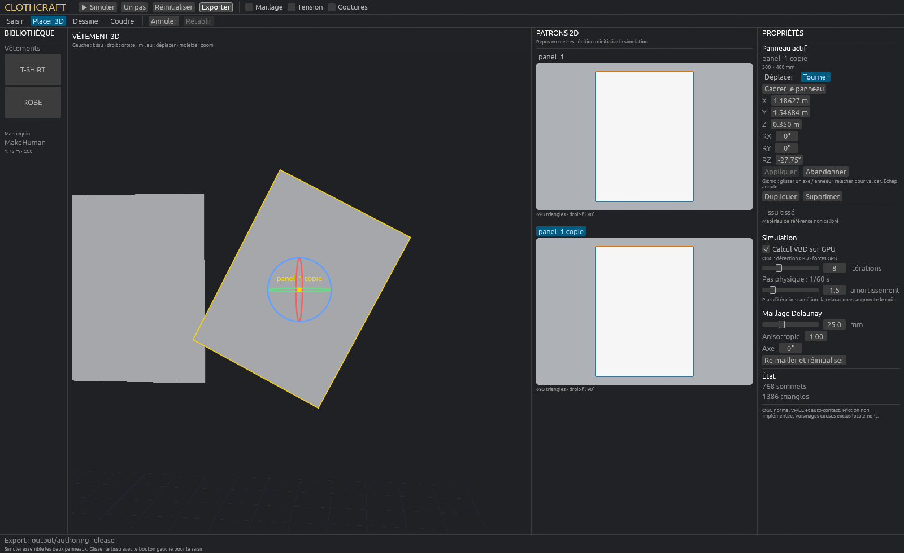

# First garment authoring slice

Launch `scripts/start-atelier.ps1` or `cargo run --release --locked -j 2 --bin cloth-fit -- --steps 0 --view --output output/atelier`.

1. **Dessiner**: click a straight contour in the 1 m square (50 mm grid, 10 mm snap), then the first point or **Créer le panneau**. Backspace removes the last point; Escape clears the draft. **Nouveau vêtement** replaces the existing panels on successful creation; undo restores them. Otherwise the new panel is added. The first fabric is assigned; a new panel starts beside the avatar.
2. **Placer 3D**: select a panel in 2D or click its visible triangles in 3D. Drag a colored axis to translate or choose **Tourner** and drag a ring. **Cadrer le panneau** brings an off-screen panel into view. Numeric positions are meters, rotations degrees. Gizmo release commits; numeric fields use **Appliquer**. Escape or **Abandonner** discards the preview. Right/middle/wheel still control the camera. Near edge-on handles need a camera orbit or numeric input.
3. **Coudre**: click two boundary segments in the 2D cards. Check lengths and endpoint labels (`A0 ↔ B0`, `A1 ↔ B1`), choose reversal, then **Créer la couture**. Different lengths require **Autoriser l'embu**. Expand existing seams to remove one before reusing its edge.
4. **Simuler / Space**: returns to cloth-grab mode and starts physics. Left drag applies the existing barycentric grab force. Authoring mode restores the flat arrangement; it is not an edit of a draped rest shape.
5. **Exporter** writes template/project JSON and the existing OBJ/SVG artifacts in the chosen output folder. Reopen with `scripts/start-atelier.ps1 -ProjectPath output/atelier/fitting-project.json`. Export overwrites the fixed output names. The current fitting project stores the resolved avatar path; transferring it to another machine requires relinking that path.

**Annuler / Rétablir** stores up to 32 document edits. Duplicate/delete act on the selected panel; deleting a panel also removes its seams. The final panel cannot be deleted. Editing rest geometry, seams or placement rebuilds the garment, resets all simulation state and invalidates worker/GPU caches. No expensive triangulation or avatar reload happens on each gizmo move; only the committed document is compiled.

## Boundaries of this version

Straight simple polygons, 3–64 vertices, no holes/curves or editing existing vertices yet. Full boundary sewing only in this UI; the underlying format already supports intervals/notches. New contours use the first project fabric. No collision-safe arrangement guarantee: a gizmo can place cloth inside the body or another panel, and OGC requires a separated starting state. Fix the arrangement if initialization rejects it. The selected outline/gizmo is an overlay and can remain visible through the avatar.

The editor is split into `src/authoring.rs` (commands, validation, history, rigid transform), `src/atelier/authoring_ui.rs` (2D and properties) and `src/atelier/gizmo.rs` (3D interaction). The worker remains independent of UI cadence. `tests/authoring.rs` exercises failed-edit atomicity, rest/mass preservation, serialization, unequal seams, references after deletion and history.

Native interaction smoke, explicitly uses a GPU for the window:

```powershell
cargo run --release --locked -j 2 --bin cloth-fit -- --steps 0 --ui-authoring-smoke --output output/authoring-smoke
```

This injects actual egui pointer events to draw, translate/rotate, duplicate, sew, undo/redo and export; it checks the saved project's reload/compile and captures `ui.png`. It is separate from the CPU test suite and physical performance measurements.


